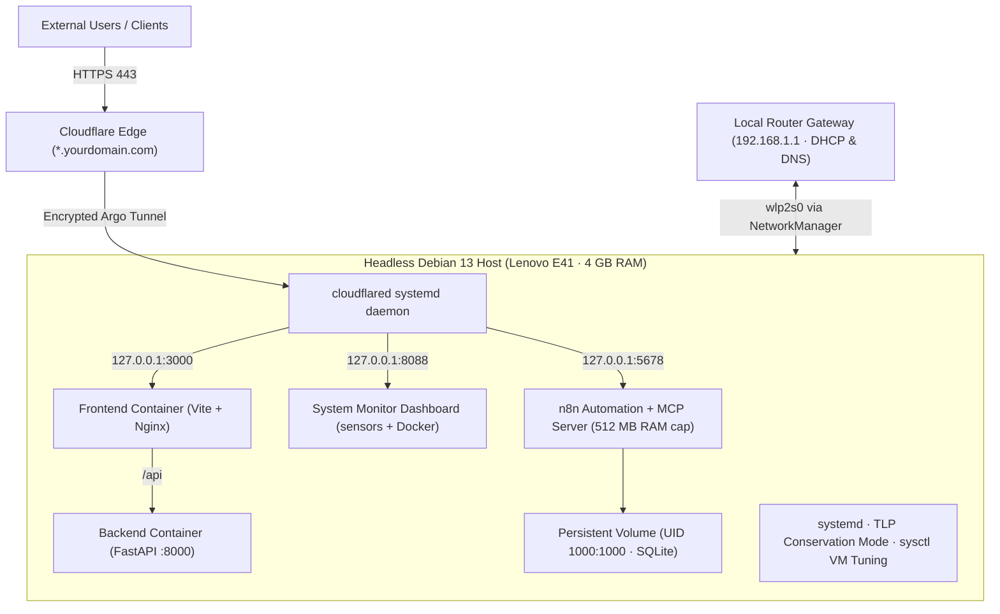

# Linux Server & Home Network Lab

**Debian 13 (Trixie) · CLI Administration · Linux Permissions · DNS & Router Troubleshooting · Service Monitoring · Docker & Cloudflare Tunnel**  
*Project Period: Sep 2026 – Nov 2026*

> **Live Server Health Dashboard:** **[https://dashboard.aurabase.systems/](https://dashboard.aurabase.systems/)**  
> Real-time telemetry served directly from the Debian 13 host via [`dashboard/server.py`](dashboard/server.py) (zero-dependency Python 3 daemon, `< 15 MB` RAM) — showing live CPU/GPU temperatures, TLP battery conservation status, memory/disk utilization, Wi-Fi I/O, and active Docker containers.

---

## Project Overview

This repository documents the architecture, system optimizations, configuration files, and troubleshooting runbooks behind my **24/7 headless Debian Linux home server**, built by repurposing a constrained **Lenovo E41 laptop** (4 GB RAM, 32.7 MB/s storage, degraded battery).

Rather than relying on managed cloud VMs, this lab demonstrates end-to-end **Linux system administration, network/DNS diagnostics, hardware power & I/O tuning, containerized service deployment, and remote observability** on real bare-metal hardware.

### Quick Summary for Recruiters & Hiring Managers
* **Built from scratch on bare metal:** Configured a headless Debian 13 Linux server operating continuously without a GUI.
* **Solved real network outages:** Diagnosed and resolved a multi-layer post-reboot outage (Cloudflare Error 1033) caused by conflicting Linux network managers (`ifupdown` vs. `NetworkManager`), subnet/DHCP mismatches against router logs, and missing DNS resolution.
* **Engineered for reliability under tight hardware limits:** Prevented battery swelling/wear using kernel ACPI charge thresholds, tuned disk/swap VM settings for slow 32.7 MB/s storage, and capped container memory so services stay responsive within 4 GB RAM.
* **Automated monitoring & zero-port-forwarding access:** Deployed Dockerized web applications, workflow automation, and a live thermal/container monitoring dashboard behind an encrypted Cloudflare Tunnel (`cloudflared`).

---

## Alignment with Resume Experience

| Resume Skill Area | Hands-On Implementation in This Lab | Documentation |
| :--- | :--- | :--- |
| **Core CLI Administration** | Headless Debian 13 setup, `systemd` service units, `sysctl` kernel tuning, `tlp` ACPI battery bypass, resource budgeting (< 4 GB RAM) | [`01-system-and-hardware-tuning.md`](docs/01-system-and-hardware-tuning.md) |
| **Linux File Permissions** | Non-root `serveradmin` service isolation, container UID/GID (`1000:1000`) volume ownership, strict settings permissions, loopback-only port binding | [`02-linux-permissions-and-systemd.md`](docs/02-linux-permissions-and-systemd.md) |
| **Local Network & DNS Troubleshooting** | Root-cause analysis using `ip`, `ping`, `/etc/resolv.conf`, `/etc/network/interfaces`, `NetworkManager`, and router DHCP logs (`192.168.1.1`) | [`03-network-dns-troubleshooting.md`](docs/03-network-dns-troubleshooting.md) |
| **Service Monitoring & Reliability** | Real-time thermal/container web dashboard ([`dashboard.aurabase.systems`](https://dashboard.aurabase.systems/) · [`dashboard/server.py`](dashboard/server.py)), `journalctl` log inspection, `ab` load testing, SQLite execution pruning | [`04-service-monitoring-and-benchmarks.md`](docs/04-service-monitoring-and-benchmarks.md) |

---

## System Architecture



---

## Highlighted Troubleshooting Case Study: Post-Reboot Network & DNS Outage

* **Symptom:** Following a server reboot, public endpoints returned **Cloudflare Error 1033 (Tunnel Offline)**. On the server, `ping 192.168.1.1` succeeded (`0%` packet loss), while `ping 1.1.1.1` had `100%` packet loss and DNS lookups failed (`Temporary failure in name resolution`).
* **Investigation:** Cross-checked router DHCP lease logs (`192.168.1.x`) against `ip a`, `ip route`, `/etc/network/interfaces`, `nmcli`, and `/etc/resolv.conf`.
* **Root Causes Found:**
  1. **Dual-Manager Conflict:** Both legacy `ifupdown` (`/etc/network/interfaces`) and `NetworkManager` were simultaneously managing the Wi-Fi interface (`wlp2s0`).
  2. **Subnet & IP Collision:** Stale static entries (`192.168.2.x` and `192.168.1.44`) conflicted with the router's active `192.168.1.1` DHCP range.
  3. **Missing DNS Resolver:** Without DHCP control by `NetworkManager`, `/etc/resolv.conf` had no active nameserver entries.
* **Resolution:** Stripped `wlp2s0` from `/etc/network/interfaces` (leaving loopback only) and standardized `wlp2s0` under `NetworkManager` DHCP with early-boot `connection.autoconnect yes`. Restored clean routing, automatic DNS resolution, and automatic `cloudflared` tunnel recovery on boot.

Full technical write-up: [`docs/03-network-dns-troubleshooting.md`](docs/03-network-dns-troubleshooting.md)

---

## Verified Benchmarks & Operational Metrics

| Metric | Measured Result | Engineering Context |
| :--- | :--- | :--- |
| **Local Web Concurrency** (`ab -n 500 -c 10`) | **2,081.46 RPS**, **0 failed requests** | `4.8 ms` mean batch time; `1.1 ms` frontend TTFB; `2.9 ms` backend TTFB |
| **Public Tunnel Latency** (`curl`) | **~637 ms** cold total fetch | Includes Cloudflare Edge + Tunnel round-trip (`~91 ms` internal stack time) |
| **Thermal Stability** (`sensors`) | **55.0°C** steady state | `k10temp` & `amdgpu` under headless workload (below `70°C` high threshold) |
| **Battery Protection** (`tlp` / `ideapad_acpi`) | **0.00 W** battery power draw | AC wall bypass enabled (`conservation_mode = 1`) for `25.1%` health battery |
| **Automation Memory Budget** | **< 512 MB** heap limit | `NODE_OPTIONS=--max-old-space-size=512` + embedded SQLite (saves ~150–250 MB RAM) |

---

## Repository Structure

```text
Home-Lab/
├── README.md                                   # Project overview, live dashboard link & resume mapping
├── .env.example                                # Environment template (no secrets committed)
├── .gitignore                                  # Excludes secrets, logs, and local data
├── dashboard/
│   └── server.py                               # Live server health dashboard (https://dashboard.aurabase.systems/)
├── docs/
│   ├── 01-system-and-hardware-tuning.md        # Debian 13, TLP AC bypass, sysctl I/O & RAM tuning
│   ├── 02-linux-permissions-and-systemd.md     # User isolation, UID/GID volume permissions, systemd
│   ├── 03-network-dns-troubleshooting.md       # Error 1033 post-reboot DNS/DHCP/subnet incident report
│   └── 04-service-monitoring-and-benchmarks.md # Monitoring dashboard, sensors, ab benchmarks, MCP CLI
├── configs/
│   ├── network/interfaces.clean                # Loopback-only /etc/network/interfaces
│   ├── sysctl/99-homelab-tuning.conf           # Dirty page & swappiness kernel parameters
│   ├── tlp/tlp-conservation.conf               # Laptop AC-bypass battery conservation config
│   ├── systemd/
│   │   ├── aurabase-dashboard.service          # Systemd unit for live monitoring dashboard
│   │   └── n8n.service                         # Auto-start systemd unit for containerized automation
│   ├── cloudflared/config.example.yml          # Sanitized Cloudflare Tunnel ingress routing
│   └── docker/n8n-compose.yml                  # Low-RAM SQLite Docker Compose configuration
└── scripts/
    ├── health-check.sh                         # CLI verification script (network, DNS, services, thermals)
    └── n8n_mcp_client.py                       # Sanitized Python CLI client for n8n MCP API
```

---

## Quick Verification Commands (CLI)

Run directly on the Debian server (or use [`scripts/health-check.sh`](scripts/health-check.sh)):

```bash
# 1. Verify single clean IP, default gateway (192.168.1.1), and DNS resolution
ip a show wlp2s0 && ip route
ping -c 3 google.com

# 2. Verify systemd services & Cloudflare Tunnel
sudo systemctl status cloudflared n8n.service docker --no-pager

# 3. Inspect container health and hardware thermals
docker ps --format "table {{.Names}}\t{{.Status}}\t{{.Ports}}"
sensors
```

---

*Note: All credentials, tokens, tunnel UUIDs, personal domains, and Wi-Fi identifiers have been sanitized or replaced with environment-variable placeholders for public repository security.*
